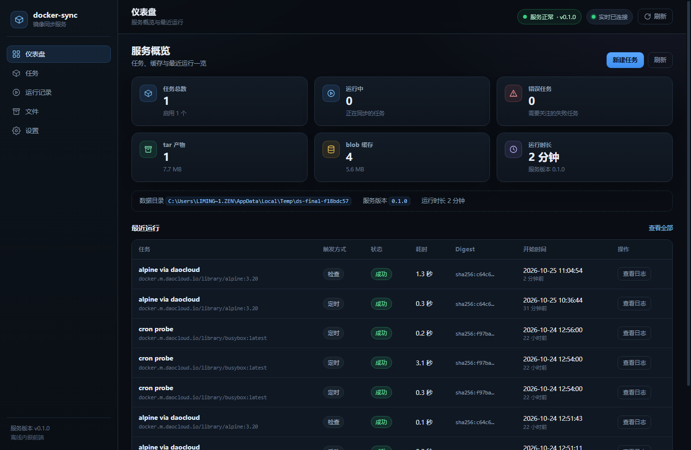
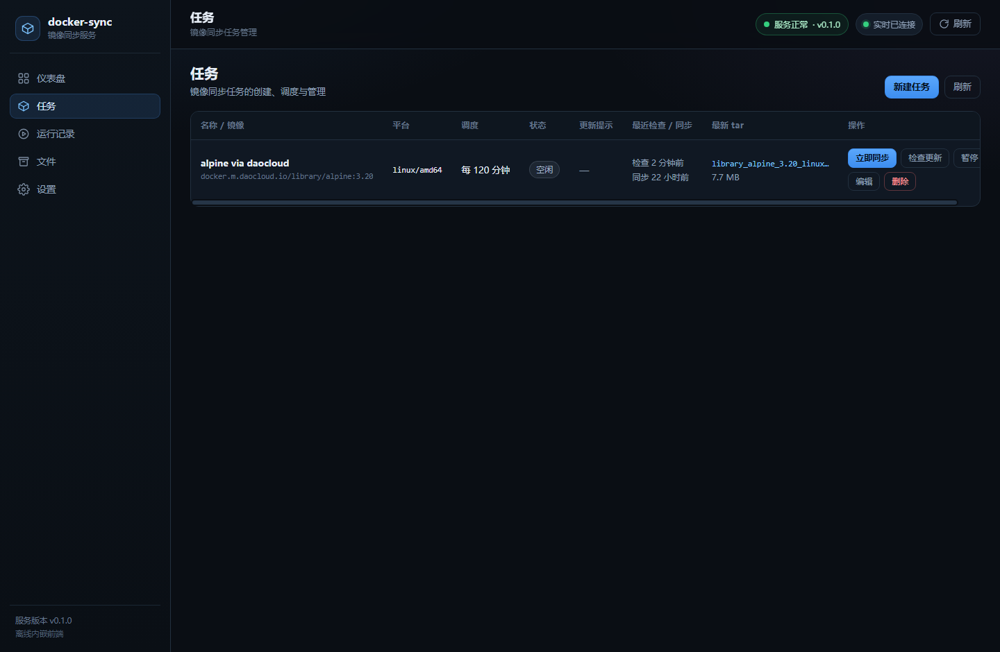
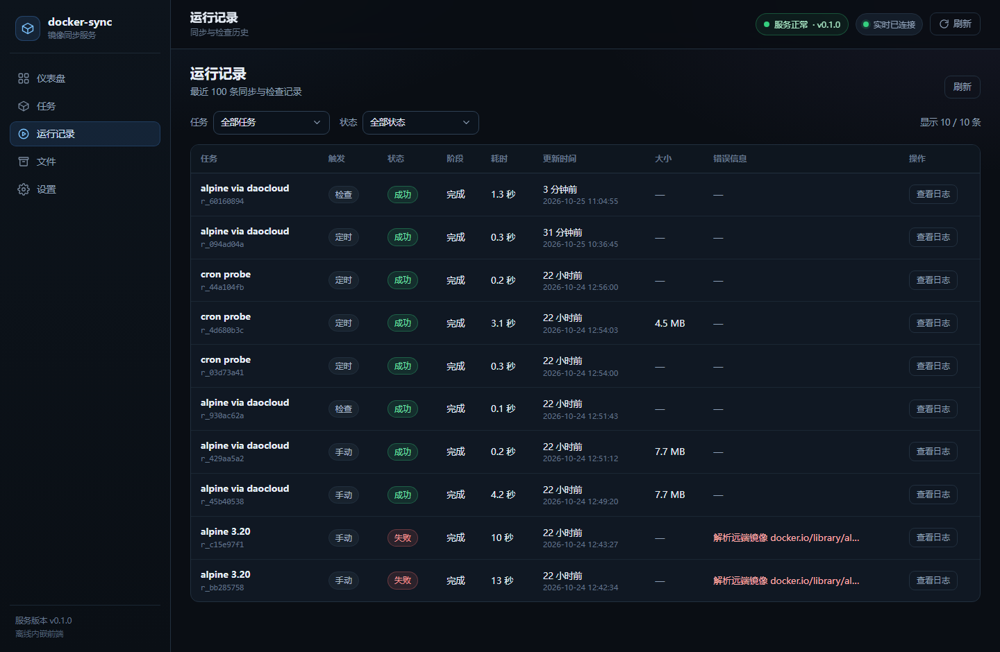
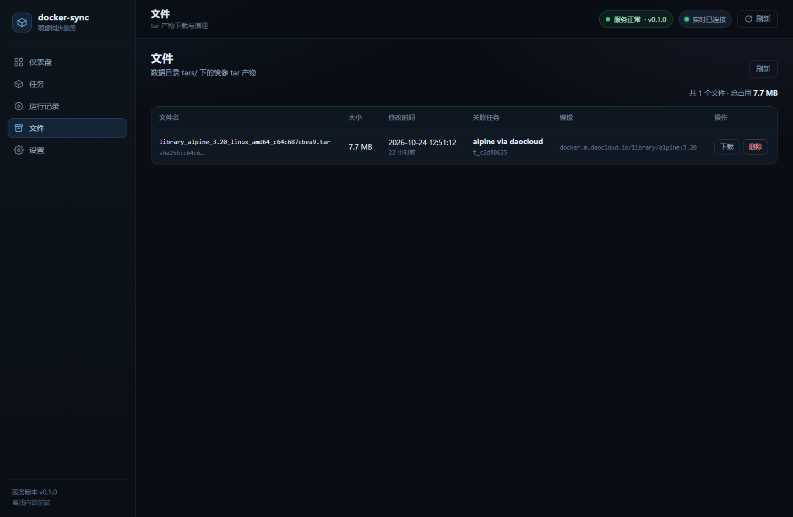
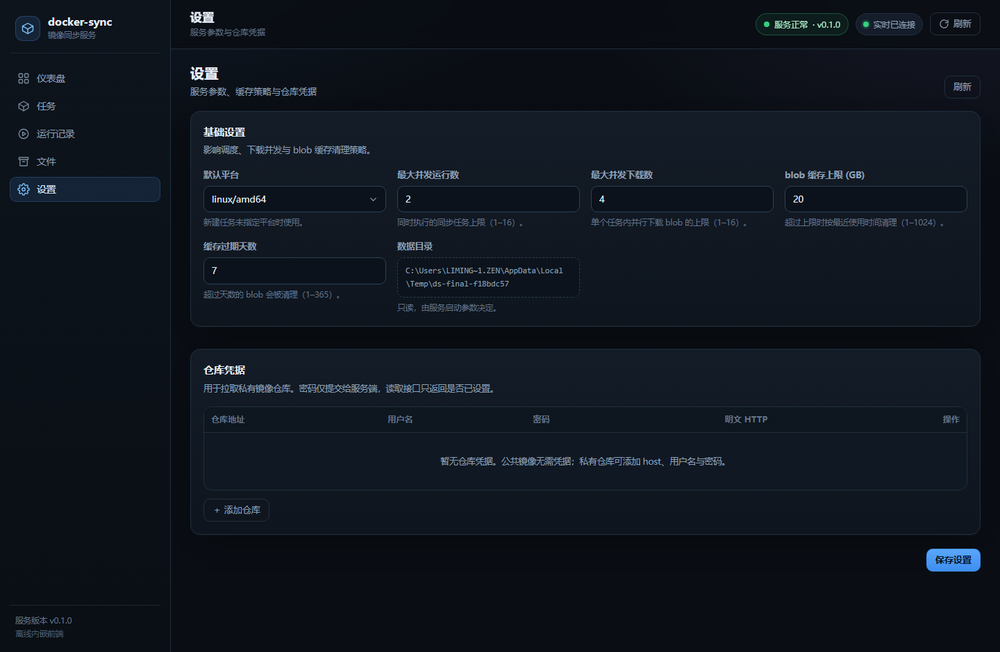
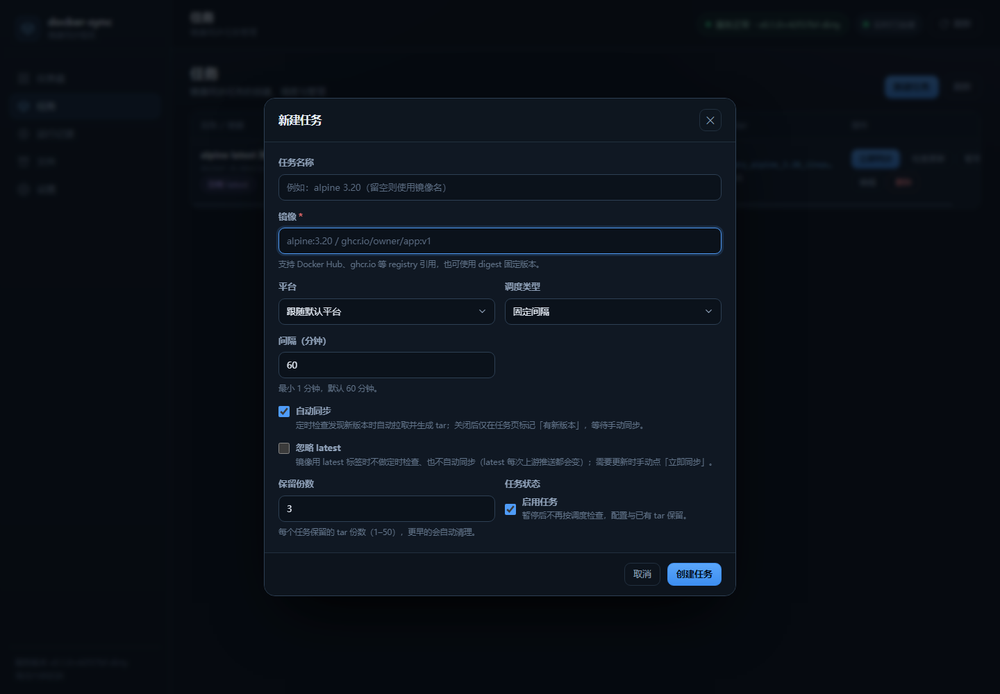
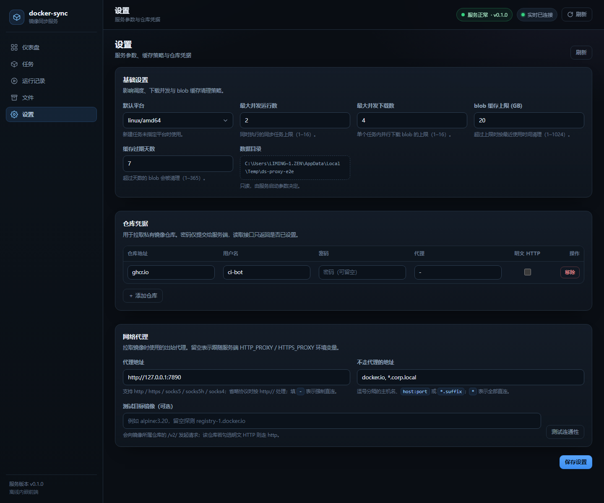

# docker-sync

`docker-sync` 是一个用 Go 编写的 Docker 镜像同步服务：它**不依赖宿主机的 docker daemon，也不需要挂载 `/var/run/docker.sock`**，而是直接通过 [Docker Registry HTTP API V2](https://distribution.github.io/distribution/spec/api/)（兼容 OCI Distribution）拉取镜像 manifest 与 blob，在本地内容寻址缓存（CAS）中保存层数据，最后拼装成标准 `docker save` 格式的 tar 包。用户把 tar 下载到任意装有 Docker 的机器后执行 `docker load -i` 即可使用，适合隔离环境、跳板机、内网镜像搬运和离线部署。

服务自带内嵌的纯静态 Web 控制台（`//go:embed`，无 CDN、无前端构建步骤），开箱即用：任务增删改查、手动同步、定时检查更新、运行日志、tar 文件下载与删除、全局设置都在一个页面里完成。

## 为什么不用 `docker pull`？

| 常见做法 | 局限 | docker-sync 的做法 |
| --- | --- | --- |
| 在目标机 `docker pull` | 目标机必须能直连外网/镜像仓库 | 由能联网的 docker-sync 拉取，产出 tar，离线搬运 |
| 挂载宿主机 `docker.sock` 调 `docker save` | 需要 root/daemon 权限，容器逃逸风险高，Windows/macOS 路径麻烦 | 不接触 daemon，只用普通 HTTPS 出站 |
| 依赖 `skopeo`/`crane` | 多一个外部二进制，脚本化能力弱 | 单个自包含 Go 二进制 + Web UI + REST API |

docker-sync 只做「拉取 → 缓存 → 打包 → 下载」，**不支持 push**，也不会修改远端仓库。

## 功能特性

- **无需 Docker daemon / socket**：纯 Registry v2 HTTP API 客户端，容器内即可运行。
- **多平台镜像**：任务可指定 `linux/amd64`、`linux/arm64`、`linux/arm/v7` 等平台，自动解析 manifest list / OCI index。
- **内容寻址缓存（CAS）**：blob 按 sha256 落盘，多个任务、多次同步之间自动复用，未变化的层不会重复下载。
- **增量更新检测**：定时解析远端 manifest，与上次成功同步的 digest 比对；无变化时不下载，有变化时可自动同步。
- **定时策略**：固定间隔（interval）或 5 段标准 cron（服务器本地时区）。
- **docker save 兼容产物**：`manifest.json` + `<config>.json` + `<layerdigest>/layer.tar`，层已解压为 `layer.tar`，`docker load -i` 可直接加载；发布前会重新读取归档做完整性校验。
- **任务级保留策略**：每个任务保留最近 N 份 tar（`keepVersions`，1–50，默认 3），旧文件自动清理。
- **私有仓库认证**：设置页按 host 配置用户名/密码，支持 Basic 与 Bearer token challenge；局域网明文 HTTP registry 可勾选 `insecure`。
- **镜像加速站点**：开启后自身即是一套只读的 Registry v2 pull-through 缓存，docker 客户端可直接 `docker pull 本服务地址/library/alpine:3.20`，与同步任务共享 blob 缓存。
- **可观测性**：运行记录包含阶段、下载字节数、复用 blob 数、逐行日志（最多 500 行）；仪表盘汇总任务、tar、blob 缓存占用。
- **零外部依赖运行**：前端与静态资源全部编译进二进制；运行镜像仅需 CA 证书和时区数据。
- **状态持久化**：`state.json` 原子写入（临时文件 + fsync + rename），异常退出后可恢复；损坏时自动备份为 `state.json.broken` 并以默认设置启动。
- **SSE 实时刷新**：前端通过 `/api/events` 接收任务/运行/文件/设置变更事件。

## 界面预览

内嵌 Web 控制台（1440×940 实拍，深色主题），五个页面 + 新建任务表单 + 网络代理卡片：

| 仪表盘 | 任务 |
| --- | --- |
|  |  |

| 运行记录 | 文件 |
| --- | --- |
|  |  |

| 设置 | 新建任务 |
| --- | --- |
|  |  |

| 网络代理 |
| --- |
|  |

## 架构简述

```
┌────────────┐   HTTPS (Registry v2 / OCI Distribution)
│ Web 控制台  │        │
│ /api/*     │        ▼
└─────┬──────┘   ┌──────────────────────────────┐
      │          │ 1. Resolve                    │
      │          │    manifest list → 平台 manifest│
      │          │    → config digest + layer 列表 │
      │          ▼                                │
      │     ┌──────────────────┐                  │
      │     │ 2. 并发下载 blob   │◄─────────────────┘
      │     └────────┬─────────┘
      │              ▼
      │     ┌──────────────────────────────┐
      │     │ 3. CAS 缓存                   │
      │     │    data/blobs/sha256/<hex>    │
      │     │    校验 sha256 后原子提交      │
      │     └────────┬─────────────────────┘
      │              ▼
      │     ┌──────────────────────────────┐
      │     │ 4. 打包 docker save tar       │
      │     │    manifest.json              │
      │     │    <config>.json              │
      │     │    <layerdigest>/layer.tar    │
      │     │    重新读取校验后发布          │
      │     └────────┬─────────────────────┘
      ▼              ▼
 data/tars/*.tar → 浏览器下载 → 宿主机 docker load -i
```

目录与职责：

| 路径 | 职责 |
| --- | --- |
| `cmd/server` | 入口：解析 flag/env，装配 store、CAS、scheduler、API，优雅关闭 |
| `internal/registry` | Registry v2 / OCI 客户端：引用解析、认证、manifest 解析、并发 blob 下载 |
| `internal/cas` | 内容寻址 blob 缓存（sha256 校验、原子写入、GC） |
| `internal/save` | 将 manifest + config + blob 组装成 `docker save` 兼容 tar，并做归档校验 |
| `internal/scheduler` | interval/cron 调度、运行队列、并发控制、同步流水线、保留策略、blob GC |
| `internal/store` | `state.json` 持久化（任务、运行、tar 索引、设置） |
| `internal/api` | REST、SSE、tar 下载、内嵌前端托管 |
| `internal/webui` | `//go:embed` 的静态前端页面 |
| `docs/API.md` | 前后端 HTTP API 契约（中文） |
| `docs/DEPLOY.md` | 容器部署、权限、反向代理与故障排查 |

## 快速开始

### 方式一：Docker Compose（推荐）

要求：Docker Engine + Compose v2（本机或目标服务器均可，docker-sync 自身不需要 docker CLI）。

```bash
cd docker-sync

# 1. 准备数据目录。容器以非 root 用户 UID 10001 运行，
#    绑定挂载的宿主机目录需要可写（Linux/macOS；Windows Docker Desktop 通常无需处理）。
mkdir -p data
sudo chown -R 10001:10001 data

# 2. 构建并启动
docker compose up -d --build

# 3. 打开控制台
#    http://localhost:8080
```

数据持久化在 `./data`，升级镜像不会丢失任务与 tar 文件。

> 只在本机使用镜像构建时，也可以直接用 `docker build -t docker-sync:local .`，然后
> `docker run -d --name docker-sync -p 8080:8080 -v "$PWD/data:/data" docker-sync:local`。
> 需要显式传入环境变量时见 [docs/DEPLOY.md](docs/DEPLOY.md)。

#### 构建时连不上 Docker Hub

`docker build` 需要拉取 `golang:1.25-alpine` 与 `alpine:3.22` 两个基础镜像（以及 apk 源与
Go module 源）。国内网络常见报错：

```
ERROR: failed to resolve source metadata for docker.io/library/golang:1.25-alpine: ... EOF
# 或旧版 Dockerfile 里的 frontend 镜像
ERROR: failed to resolve source metadata for docker.io/docker/dockerfile:1: ... EOF
```

本项目 Dockerfile **不使用** `# syntax=docker/dockerfile:1`（该指令会额外拉 frontend 镜像），
且基础镜像、apk 源、GOPROXY 全部可用 build-arg 覆盖：

```bash
docker build \
  --build-arg GO_IMAGE=docker.m.daocloud.io/library/golang:1.25-alpine \
  --build-arg RUNTIME_IMAGE=docker.m.daocloud.io/library/alpine:3.22 \
  --build-arg APK_MIRROR=https://mirrors.aliyun.com/alpine \
  --build-arg GOPROXY=https://goproxy.cn,direct \
  -t docker-sync:local .
```

Compose 下用同名环境变量即可（`docker compose up -d --build` 前导出）：

```bash
export GO_IMAGE=docker.m.daocloud.io/library/golang:1.25-alpine
export RUNTIME_IMAGE=docker.m.daocloud.io/library/alpine:3.22
export APK_MIRROR=https://mirrors.aliyun.com/alpine
export GOPROXY=https://goproxy.cn,direct
docker compose up -d --build
```

也可以给 Docker daemon 配置镜像加速（`/etc/docker/daemon.json` 的 `registry-mirrors`），
这样所有 `docker pull` / `docker build` 都会自动走镜像站，无需逐个传参。

### 方式二：本机直接运行（开发/调试）

要求：Go 1.25+（项目 `go.mod` 为 `go 1.25`，更新版本的 Go 也可构建）。

```bash
# 开发运行（默认监听 :8080，数据目录 ./data）
go run ./cmd/server

# 或先编译再运行
go build -trimpath -o bin/docker-sync ./cmd/server
./bin/docker-sync -addr :8080 -data ./data -log-level debug
```

浏览器访问 `http://localhost:8080` 即可。

### 方式三：直接下载编译好的可执行文件

推送 `v*` 标签时 GitHub Actions 会自动交叉编译并发布到 Releases 页（见下方[发布](#发布github-actions)），
不需要本机安装 Go：

| 平台 | 产物 |
| --- | --- |
| Linux x86_64 | `docker-sync_<版本>_linux_amd64`（附 `.tar.gz`） |
| Linux arm64 | `docker-sync_<版本>_linux_arm64`（附 `.tar.gz`） |
| Windows x86_64 | `docker-sync_<版本>_windows_amd64.exe`（附 `.zip`） |
| 校验和 | `SHA256SUMS.txt` |

```bash
chmod +x docker-sync_0.1.0_linux_amd64
./docker-sync_0.1.0_linux_amd64 -addr :8080 -data ./data
```

```powershell
.\docker-sync_0.1.0_windows_amd64.exe -addr :8080 -data .\data
```

Windows 上数据目录里含 tar、blob 缓存与 `state.json`，建议放在磁盘空间充足的位置（默认 `.\data`）。

## 配置项

优先级：命令行 flag > 环境变量 > 默认值。三个配置项都同时支持 flag 与 env。

| flag | 环境变量 | 默认值 | 说明 |
| --- | --- | --- | --- |
| `-addr` | `ADDR` | `:8080` | HTTP 监听地址，例如 `:8080`、`127.0.0.1:9000` |
| `-data` | `DATA_DIR` | `./data` | 数据目录（状态、CAS、tar 都放在这里） |
| `-log-level` | `LOG_LEVEL` | `info` | 日志级别：`debug` / `info` / `warn` / `error` |
| （无） | `TZ` | 容器内 `UTC` | 影响 cron 的本地时区解释与容器内日志时间；镜像已安装 `tzdata` |

示例：

```bash
docker run -d \
  --name docker-sync \
  -p 8080:8080 \
  -v "$PWD/data:/data" \
  -e LOG_LEVEL=debug \
  -e TZ=Asia/Shanghai \
  docker-sync:local
```

Web 控制台「设置」页里还有一组运行时配置，保存在 `state.json`，无需重启容器：

| 设置项 | 默认值 | 范围 | 说明 |
| --- | --- | --- | --- |
| `defaultPlatform` | `linux/amd64` | 合法 `os/arch[/variant]` | 任务未指定平台时使用 |
| `maxConcurrentRuns` | `2` | 1–16 | 同时执行的同步/检查任务数 |
| `maxConcurrentDownloads` | `4` | 1–16 | 单个同步任务内并发下载 blob 数 |
| `blobCacheMaxGB` | `20` | 1–1024 | blob 缓存体积上限 |
| `blobCacheMaxAgeDays` | `7` | 1–365 | blob 缓存最长保留天数 |
| `registries` | 空 | — | 私有仓库凭据，见下文 |
| `proxyUrl` / `noProxy` | 空 | — | 网络代理，见「网络代理」一节 |
| `mirror` | 关闭 | — | 镜像加速站点（只读 pull-through 缓存），见「镜像加速站点」一节 |

## 数据目录结构

默认数据目录为 `./data`，容器内为 `/data`：

```
data/
├── state.json                 # 任务、运行记录、设置、tar 索引（原子写入）
├── state.json.broken          # state.json 损坏/不可读时保留的坏文件（再次损坏会覆盖）
├── blobs/                     # 内容寻址的 blob 缓存（CAS）
│   └── sha256/
│       ├── 0123abcd…（64 位十六进制）
│       └── …
└── tars/                      # 生成的 docker save tar
    ├── library_alpine_3.20_linux_amd64_1a2b3c4d5e6f.tar
    └── …
```

- `state.json`：重启后恢复任务、运行历史、设置与 tar 索引；写入是「临时文件 + fsync + rename」，
  保存过程中可能短暂出现 `.state-*.tmp`。
- tar 的元数据（所属任务、镜像、manifest digest）记录在 `state.json` 的 `files` 索引里，
  **不会额外生成同名 `.json` sidecar 文件**；目录里以实际 `.tar` 为准，索引会在启动时与磁盘对账。
- tar 文件名格式：`<repository 中 / 替换为 _>_<tag>_<platform>_<manifest digest 前 12 位>.tar`，
  例如 `ghcr.io_owner_app_v1_linux_arm64_0123456789ab.tar`；digest 固定的引用没有 tag 段。
- tar 内部结构为 docker save 经典格式：

  ```
  manifest.json            # [{"Config":"<config>.json","RepoTags":["alpine:3.20"],"Layers":["<hex>/layer.tar",…]}]
  <config>.json            # 镜像 config（原样嵌入）
  <layerdigest>/layer.tar  # 已解压的层（gzip/zstd 在打包时解开）
  ```

- 删除 tar 的三种方式：控制台「文件」页删除、`DELETE /api/files/{name}`、删除任务时级联删除。
- blob 缓存由服务自动清理：启动时一次，之后每 6 小时一次，按「最后修改时间」优先淘汰；
  缓存被复用时会刷新访问时间，所以热门层不会被误删。tar 文件不参与该清理。

## 使用流程

1. **新建任务**：控制台「任务」→「新建」，填写：
   - 镜像引用：`alpine:3.20`、`ghcr.io/owner/app:v1`、`registry.local:5000/team/app:1.0`，
     也可锁定 digest：`busybox@sha256:<64 位十六进制>`；
   - 平台（可空，空则用默认平台）；
   - 调度：固定间隔（最小 1 分钟）或 cron；
   - 自动同步（`autoSync`）：定时检查发现新 digest 时是否自动拉取并生成 tar；
   - 保留份数（`keepVersions`）。
2. **首次同步**：点「同步」（或在运行记录页手动触发）。接口立即返回，进度通过 SSE/轮询展示，
   阶段依次为 `resolving → downloading → packing → done`。
3. **获取 tar**：任务卡片或「文件」页点下载；也可以 `curl -O http://<host>:8080/api/files/<name>.tar`。
4. **加载镜像**（在任意有 Docker 的机器上）：

   ```bash
   docker load -i library_alpine_3.20_linux_amd64_1a2b3c4d5e6f.tar
   docker images | grep alpine
   ```

   tar 里的 `RepoTags` 就是任务填写的镜像引用，`docker load` 后即按该标签出现。
5. **后续更新**：等待定时检查；检测到新 digest 且开启自动同步时会自动产出新 tar，
   否则任务会显示「有更新」，由你手动同步。

## 定时检查与更新检测

- **interval**：按「上次检查时间 + 间隔」计算 `nextRunAt`，调度循环每 30 秒检查一次到期任务；
  新建任务不会立刻触发，第一次检查发生在创建后一个间隔（默认 60 分钟）。
- **cron**：标准 5 段表达式 `分 时 日 月 周`，例如 `0 */6 * * *`（每 6 小时）、`30 2 * * 1`（每周一 02:30）；
  按**服务器本地时区**解释，容器里默认 UTC，需要北京时间请设置 `TZ=Asia/Shanghai`。
- **更新检测原理**：解析目标平台的 manifest，取 `Docker-Content-Digest`（即平台 manifest 的 sha256），
  与任务上次成功同步的 `lastDigest` 比对。不同则 `updateAvailable=true` 并记录 `remoteDigest`。
- **检查 vs 同步**：
  - 定时/手动「检查」只解析 manifest，不下载层；运行记录状态为 `success`，并用
    `updateAvailable` 表示是否有更新。
  - 定时检查发现更新且任务开启 `autoSync` 时，会追加一次 `trigger=schedule` 的同步。
  - 同步时若 digest 未变、且最新 tar 仍在磁盘，则直接记为 **`skipped`**，不重复下载；
    可用 `force=true`（API）或页面上的强制同步绕过该优化。
- 失败会写入任务的 `lastError`，任务状态变为 `error`；下次检查/同步成功自动恢复。

## tar 保留策略（keepVersions）

- 每个任务在**每次成功同步后**，按 tar 的修改时间倒序保留最近 `keepVersions` 份，超出的旧 tar
  从磁盘和索引中删除；`keepVersions` 默认 3，允许 1–50。
- 保留策略只作用于该任务自己生成的 tar，不会影响其他任务。
- 删除任务会删除它产生的全部 tar，但**不会**删除 blob 缓存（缓存是跨任务共享的）。
- 缓存与 tar 是两套独立的回收机制：tar 由 `keepVersions`/手动删除控制，blob 由
  `blobCacheMaxGB` / `blobCacheMaxAgeDays` 的定时 GC 控制。

## 网络代理

有些 registry 只有走代理才能访问（例如 `registry.k8s.io`、`gcr.io`、`ghcr.io` 在部分网络下不通）。
控制台「设置」→「网络代理」中可以配置，保存后立即生效，无需重启：

| 字段 | 示例 | 说明 |
| --- | --- | --- |
| `proxyUrl`（全局） | `http://127.0.0.1:7890`、`socks5://127.0.0.1:7890`、`192.168.1.10:3128` | 所有 registry 出站请求走这个代理；留空 = 跟随环境变量 `HTTP_PROXY`/`HTTPS_PROXY`/`NO_PROXY`；填 `-` = 强制直连 |
| `noProxy` | `docker.io, *.corp.local, 10.0.0.1:5000` | 逗号分隔的直连列表，命中这些 host 时不走代理；`*` 表示全部直连 |
| `registries[].proxyUrl` | `-` | 按仓库覆盖：留空继承全局，`-` 表示该仓库强制直连，其他值覆盖全局 |

- 支持 `http`、`https`、`socks5`、`socks5h`、`socks4`；地址省略协议时默认按 `http://` 处理。
- 代理作用于所有 registry 出站请求：拉 manifest、下载 blob、Bearer token 换票。
- 「测试连通性」按钮会按当前配置访问对应 registry 的 `/v2/`（可填一个镜像引用来指定仓库），
  返回是否可达、探测地址与耗时；代理认证失败会提示 407。
- 容器部署也可以用环境变量让容器内进程走代理（见 docs/DEPLOY.md）：
  `HTTP_PROXY=http://host.docker.internal:7890`、`NO_PROXY=localhost,127.0.0.1`。
  环境变量对进程内所有出站请求生效，页面设置只作用于 registry 请求且优先级更高。

## 镜像加速站点

本服务还能当**内网的 Docker 镜像加速站**用：开启后 `/v2/` 就是一套只读的 Registry v2 pull-through 缓存，
docker 客户端直接拉取，第一次回源、之后命中本地 blob 缓存。它和同步任务共用同一份 blob 缓存，
所以给 CI 用过的镜像，同步任务不需要重新下载（反之亦然）。

控制台「设置」→「镜像加速」：

| 字段 | 默认 | 说明 |
| --- | --- | --- |
| 启用镜像加速站点 | 关 | 打开后 `http://<本服务地址>/v2/` 对外提供 Registry v2 读接口 |
| 允许代理任意上游仓库 | 关 | 关闭时只服务下面列出的上游；打开后请求路径首段看起来是主机名（含 `.` 或 `:`）就按该主机回源 |
| 允许的上游仓库 | `docker.io` | 每行一个主机名，**第一行是默认上游**；不在列表里的名称整体作为默认上游的仓库名 |
| tag 缓存时长 | 60 分钟 | tag → digest 映射的复用时长，过期后向上游确认 tag 是否移动 |

客户端两种用法（把 `192.168.1.10:8080` 换成这台服务器的实际 IP；`localhost` 只在服务本机上有效，
其它机器必须用 IP 或域名）：

```bash
# 1) 直接当仓库地址用，任何客户端都支持
docker pull 192.168.1.10:8080/library/alpine:3.20
docker pull 192.168.1.10:8080/ghcr.io/owner/app:v1     # 上游 ghcr.io 需在白名单里

# 2) 给整个 daemon 配镜像加速（只对 Docker Hub 生效）
#    Linux: /etc/docker/daemon.json
#    Docker Desktop: Settings → Docker Engine（同一个 JSON）
#    {"registry-mirrors": ["http://192.168.1.10:8080"],
#     "insecure-registries": ["192.168.1.10:8080"]}
```

- **本服务只监听明文 HTTP，`insecure-registries` 是必须的**。docker 客户端对没见过的仓库会先试
  `https://`，于是报 `http: server gave HTTP response to HTTPS client`（部分版本表述为"不支持 https 协议"）
  或 `unsupported protocol scheme` —— 把地址加进 `insecure-registries` 后重启 daemon 即可。
  `registry-mirrors` 里要写 `http://` 前缀，`insecure-registries` 里不能写协议前缀。
- 想彻底省掉 `insecure-registries`：在前面挂一层带证书的 Nginx/Caddy 反代，把 HTTPS 转成对内的
  HTTP（见 docs/DEPLOY.md「镜像加速站点」）。
- 服务地址怎么填：设置页「镜像加速」卡片里的「客户端用法」会显示当前**可用的本机 IP**（页面用
  `localhost` 打开时会自动换成局域网 IP）；也可以在服务器上 `ipconfig`（Windows）/ `ip addr`（Linux）
  自查，先 `curl http://192.168.1.10:8080/v2/` 确认返回 `{}` 再配 docker。
- 只读：`docker push`、`blobs/uploads`、`tags/list` 都不支持（返回 405/404）。
- 安全：`allowAll` 关闭时只有白名单内的上游会被代理，避免变成公开的开放代理；建议内网使用时保持关闭，
  只列出真正需要的上游。服务本身**没有鉴权**，不要把端口直接暴露到公网。
- 上游限流（Docker Hub 429）会原样透传给客户端；配置「仓库凭据」可以让回源带账号，缓解限流。
- 代理与仓库凭据同样作用于镜像加速的回源请求（manifest、blob、token 都走同一个客户端），
  并且「设置 → 网络代理」保存后立即生效。
- 存储：缓存按 blob 摘要去重，遵守「blob 缓存上限 / 过期天数」，超过后由清理任务回收。
- 「镜像加速」卡片底部有实时统计（manifest/blob 命中与回源、累计下发字节），对应接口
  `GET /api/mirror/stats`。

## 私有仓库认证

在控制台「设置」→「仓库凭据」中按 host 添加：

| 字段 | 示例 | 说明 |
| --- | --- | --- |
| `host` | `docker.io`、`ghcr.io`、`registry.local:5000` | 只填主机名（可带端口），不要带 `https://` 或路径 |
| `username` | `robot$ci` | 仓库用户名 |
| `password` | `********` | 密码/访问令牌；保存后接口只返回 `hasPassword` |
| `insecure` | 不勾选 | 勾选后对该 registry 使用明文 HTTP（仅限内网） |
| `proxyUrl` | `-` | 该仓库的代理覆盖，留空继承全局（见上一节） |

- 支持 Registry 返回的 `WWW-Authenticate` 挑战：Basic 直接重试，Bearer 自动走 token 服务换取 token。
- `docker.io`、`index.docker.io`、`registry-1.docker.io` 视为同一个 host，填任意一种都生效。
- 未配置凭据的 host 按匿名访问；Docker Hub 匿名有拉取限流，建议配置账号或使用镜像加速。
- `insecure` 关闭 TLS 校验之外的方式并不存在：它会把协议切换为 `http://`，**不是**跳过证书校验。
  自签名 HTTPS registry 需要把 CA 安装到容器（挂载证书并更新）或改用受信任证书。
- ⚠️ 密码以明文保存在 `state.json` 中（HTTP 接口已做掩码）。请限制数据目录权限，
  不要把 `state.json` 提交到 Git 或放进共享目录。

## 部署

- 容器构建、运行、权限、反向代理与故障排查见 **[docs/DEPLOY.md](docs/DEPLOY.md)**。
- HTTP API 契约（前后端字段、错误码、SSE）见 **[docs/API.md](docs/API.md)**。
- 服务**没有内置鉴权**。请只监听内网/回环地址，或放在带认证的反向代理（Nginx/Caddy/Traefik）之后；
  公网暴露等于把镜像拉取能力和数据目录管理权限开放给所有人。

## 发布（GitHub Actions）

工作流文件：`.github/workflows/release.yml`。

触发方式：

1. **推 tag**（推荐）：`git tag v0.1.0 && git push origin v0.1.0` → 编译 + 创建同名 Release。
2. **手动运行**：Actions 页面选 `release` → `Run workflow`，填入版本号（如 `v0.1.0`）；
   不会新建 git tag，但会在默认分支 HEAD 上创建/更新 Release。

流水线分四步：

| Job | 内容 |
| --- | --- |
| `test` | `gofmt -l .` 无输出、`go vet ./...`、`go test ./...`，任一失败即中止发布 |
| `meta` | 从 tag 解析版本号（`v0.1.0` → `0.1.0`） |
| `build` | 矩阵编译 `linux/amd64`、`linux/arm64`、`windows/amd64`；`CGO_ENABLED=0`、`-trimpath -ldflags "-s -w -X main.version=<版本> -X main.commit=<sha>"`，Linux 打 `.tar.gz`、Windows 打 `.zip`，并生成逐个文件的 sha256 |
| `release` | 汇总所有产物 + `SHA256SUMS.txt`，用 `gh release create`（已存在则 `upload --clobber`）发布 |

构建出的版本号会显示在控制台右上角与 `GET /api/overview` 的 `version` 字段里。版本串后面还会带上 git 提交号，例如 `0.1.2+1cdc758`——本地 `go build` 会自动从 `go build` 嵌入的 VCS 信息里读取，工作区有未提交改动时再加 `-dirty`，这样“页面是不是新代码”一眼可辨：

```bash
$ ./docker-sync_0.1.2_linux_amd64 -addr :8080 &
$ curl -s localhost:8080/api/overview | grep -o '"version":"[^"]*"'
"version":"0.1.2+1cdc758"
```

注意：

- Release 里只有**裸可执行文件**，不含 Docker 镜像；容器镜像仍按 [docs/DEPLOY.md](docs/DEPLOY.md) 自行 `docker build`。
- 需要给仓库开启 Actions 写权限（工作流已声明 `permissions: contents: write`，用于创建 Release）。
- 想加 Windows arm64 或 `linux/386`，在 `release.yml` 的 `matrix` 里加一行（或删掉 `exclude`）即可。

## 开发与验证

```bash
gofmt -l .        # 应无输出
go vet ./...
go build ./...
go test ./...
```

项目无前端构建步骤：修改 `internal/webui/web/` 后重新 `go build` 即可（`go:embed` 在编译时打包）。
无 Docker CLI 的环境无法真正 `docker build`，Dockerfile 需按语法与多阶段路径人工复核。

## 常见问题（FAQ）

**Q：为什么不能直接用 `docker pull`？**
目标环境可能完全离线、只能单向拷贝文件；docker-sync 在能联网的一侧完成拉取与打包，把 tar 带过去即可。
也避免了在容器中暴露 `/var/run/docker.sock` 的安全风险。

**Q：容器里怎么拿到镜像？镜像会加载到 docker-sync 容器里吗？**
不会。tar 只是普通文件，下载到宿主机后执行 `docker load -i`。docker-sync 容器内没有 docker CLI，
不需要也不应该挂载宿主机的 Docker socket。

**Q：支持 `docker push` 或自动推送到其他 registry 吗？**
不支持。产品边界是「拉取 → tar → 手工 `docker load`」。需要推送请用 `docker load` 后再 `docker tag`/`docker push`。

**Q：tar 为什么比镜像大？**
`docker save` 格式要求层以未压缩的 `layer.tar` 保存，所以 tar 通常比 registry 中的压缩 blob 大，
这是正常现象。下载传输可走 HTTP Range/浏览器断点续传；磁盘占用可用 `keepVersions` 控制。

**Q：任务显示 `skipped` 是什么意思？**
同步时远端平台 manifest digest 与上次成功同步一致，且最新 tar 仍存在，因此跳过了下载和打包；
这不是失败。需要强制重建时用强制同步（`force=true`）。

**Q：磁盘占用怎么清理？**
- tar：在「文件」页删除，或降低任务的 `keepVersions`，或直接删除 `data/tars/*.tar`（重启后索引自动对账）。
- blob 缓存：调小设置里的 `blobCacheMaxGB` / `blobCacheMaxAgeDays`，GC 在启动时和每 6 小时执行；
  也可以停服后手工清空 `data/blobs/sha256/`（会丢失跨任务复用，但不会损坏已有 tar）。
- 注意：删除 blob **不会**影响已经生成的 tar；tar 是自包含的。

**Q：重启会不会丢任务/运行记录？**
任务、设置、tar 索引和历史运行都持久化在 `state.json`，正常重启不丢。服务关闭时未完成的运行会标记为
`canceled`；进程被强杀后，下次启动会把残留的 `running` 任务恢复为 `idle`、未完成的运行标记为
`canceled`（错误信息为「服务重启，运行已中断」）。
只有损坏的 `state.json` 会被移为 `state.json.broken` 并用默认设置启动。

**Q：多架构镜像怎么处理？**
每个任务只同步一个平台（任务字段或全局默认平台）。同一镜像的不同平台可建多个任务，
tar 文件名包含平台，互不覆盖。

**Q：镜像仓库连不上，怎么走代理？**
在「设置」→「网络代理」填 `proxyUrl`（例如 `http://127.0.0.1:7890` 或 `socks5://127.0.0.1:7890`），
`noProxy` 填不需要走代理的内网 host；也可以只给某个仓库单独配代理（填 `-` 表示强制直连）。
先用「测试连通性」验证配置，再手动同步。容器里访问宿主机上的代理要写 `host.docker.internal`
（Docker Desktop）或宿主机的内网地址，不能写 `127.0.0.1`。

**Q：端口/路径可以通过环境变量改吗？**
可以：`ADDR`、`DATA_DIR`、`LOG_LEVEL` 与对应 flag 等价；容器内默认 `-addr :8080 -data /data`。

**Q：Windows 上绑定挂载 `./data` 写不进去？**
用 Docker Desktop 的 WSL2 后端时一般无需处理；Linux 宿主机上需要让 UID 10001 可写：
`sudo chown -R 10001:10001 data`。也可以改用命名卷（`docker-sync-data:/data`）。


## SMB 远端存储

在「设置 → SMB 远端存储」启用自动上传，填写共享地址（例如 `//192.168.1.10/backups`）、共享内相对目录（例如 `docker-images`）、用户名、密码和可选域。目标目录须预先创建，并赋予账号写入、重命名及删除临时文件的权限。使用 SMB2/SMB3，无需挂载共享或授予容器特权。

上传使用内置的纯 Go SMB2/SMB3 客户端，**不需要 `samba-client`**，也不需要挂载共享或容器特权：只要容器（或直接运行的二进制）能出站访问共享主机的 445 端口即可。Windows / macOS / Linux 宿主机都无需额外安装组件。

tar 在本地生成并校验后，进入 `uploading` 阶段；上传到唯一 `.part` 临时文件，完成后重命名为原 tar 文件名，同名远端文件会替换，传输中断不会在对端留下半截文件。失败会记录运行错误并保留本地 tar，下次手动或定时同步重试；镜像 digest 不变时也会重新上传已有 tar。仅「检查更新」不会上传文件。启用前已有文件可在「文件」页对单个 tar 点「上传 SMB」补传，无需重新同步镜像；手动补传同样会生成一条运行记录（触发方式显示为「上传」，带上传进度与结果日志），可在「运行记录」页查看。

远端副本不随本地版本清理而删除，请在 NAS 上单独设置保留策略。密码与仓库凭据一样保存在数据目录的 `state.json`，读取设置接口不返回密码。更换共享地址、用户名或域后需重新填写密码。
